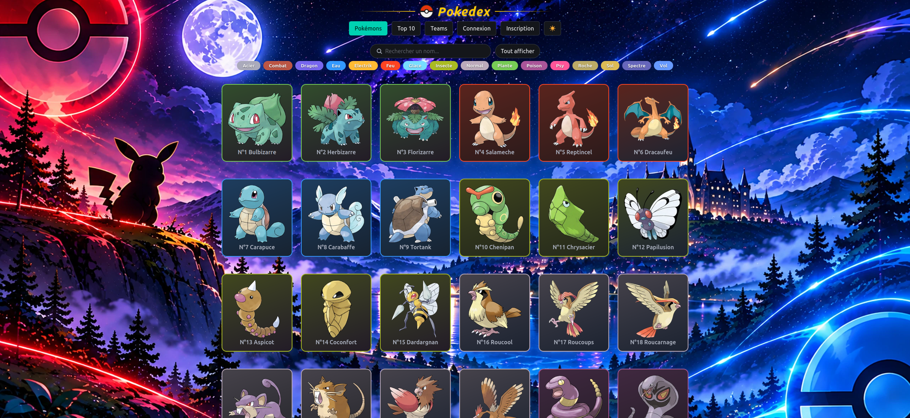
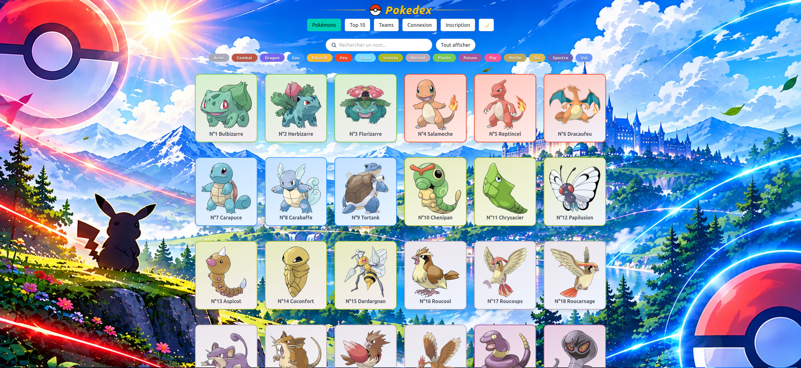

# Pokedex

| Mode sombre | Mode clair |
|---|---|
|  |  |

API REST de Pokedex (les 151 Pokemons des versions Rouge et Bleu) avec un systeme d'equipes, de favoris et de recherche, plus un petit client en Svelte pour la consommer.

Challenge solo de 5 jours réalisé en fin de bloc B (Back-End) de ma formation CDA chez O'Clock : concevoir et livrer une API REST complète. Le client Svelte a été fait plus tard, sur mon temps libre, pour finir le projet et pouvoir l'exposer.

## Ce que fait le projet

- Liste, detail et recherche de Pokemons (par nom, filtre par type côté client)
- Top 10 des Pokemons les plus mis en favori
- Inscription / connexion (mot de passe hache avec argon2, token JWT d'une heure)
- Equipes : créer, modifier, supprimer, ajouter et retirer des Pokemons
  - 6 Pokemons max par equipe, pas de doublon
  - les equipes sont privées (visibles et modifiables seulement par leur createur), sauf celles du seed qui servent d'exemples : visibles par tous, non modifiables
  - quatre scores par equipe (offensif, defensif, vitesse et un global), calculé a partir des stats des Pokemons
- Favoris : ajouter, retirer, lister les siens
- Validation des entrées avec Joi, protection XSS, gestion des erreurs centralisée

## Technos

- **API** : Node.js, Express 5, Sequelize, PostgreSQL, Joi, JWT, argon2
- **Tests** : node:test avec une base de données dediée
- **Client** : Svelte 5, Vite, Bulma

## Structure de l'API

```
api/
├── app.js          l'application Express (utilisée aussi par les tests)
├── index.js        demarrage du serveur
├── http/           requetes de test (REST Client)
├── tests/          tests unitaires et d'integration
└── src/
    ├── routes/
    ├── controllers/
    ├── services/       les regles metier (limite de 6, doublons, score...)
    ├── middlewares/
    ├── schemas/        validation Joi
    ├── models/         modeles Sequelize
    └── migrations/     creation des tables et seed
```

## Installation

Il faut Node.js et PostgreSQL.

**1. Creer les bases**

```bash
sudo -i -u postgres psql
```

```sql
CREATE USER admin_pokedex WITH LOGIN PASSWORD 'mon_mot_de_passe';
CREATE DATABASE pokedex OWNER admin_pokedex;
CREATE DATABASE pokedex_test OWNER admin_pokedex;
```

**2. Lancer l'API**

```bash
cd api
npm install
cp .env.example .env
cp .env.test.example .env.test
```

Remplir les deux fichiers (url de la base, `JWT_SECRET`, port). Le nom de la base de test doit finir par `_test`.

```bash
npm run db:reset
npm run dev
```

L'API tourne sur `http://localhost:3000`.

**3. Lancer le client**

```bash
cd client
npm install
cp .env.example .env
npm run dev
```

Le client tourne sur `http://localhost:5173`.

## Tests

```bash
cd api
npm test
```

Les tests utilisent la base `pokedex_test`, vidée avant chaque test. Ils refusent de se lancer si le nom de la base ne finit pas par `_test`, pour ne jamais toucher a la vraie.

Une amélioration possible serait de lancer les tests dans un conteneur Docker jetable, comme ça pas besoin d'installer PostgreSQL et on peut repartir sur une base vierge a chaque fois.

## Routes

| Methode | Route | Acces |
|---|---|---|
| POST | `/auth/register`, `/auth/login` | public |
| GET | `/pokemons`, `/pokemons/:id`, `/pokemons/search`, `/pokemons/popular` | public |
| GET | `/teams`, `/teams/:id` | public (equipes visibles seulement) |
| POST | `/teams` | connecte |
| PATCH, DELETE | `/teams/:id` | proprietaire |
| POST, DELETE | `/teams/:id/pokemons` | proprietaire |
| GET, POST, DELETE | `/favorites`, `/favorites/:pokemonId` | connecte |

Des exemples de requetes sont dans `api/http/`. Les conventions de nommage sont dans [NAMING_CONVENTION.md](./NAMING_CONVENTION.md).

## A savoir

- J'ai utilisé une IA pour m'aider à structurer le code et comprendre certaines notions, voire en découvrir de nouvelles, mais j'ai bien évidemment relu et testé chaque fichier.
- J'ai laissé beaucoup de commentaires dans le code, car ce projet m'a servi a apprendre : ils expliquent les notions et les choix que j'ai faits, plutot que de redire ce que fait chaque ligne.
- `cors()` autorise toutes les origines : ok pour du dev, a restreindre en production.
- Pas encore de doc Swagger ni de deploiement Docker.
- Les images des Pokemons viennent du kit fourni en formation, les personnages sont des marques de Nintendo / Game Freak / The Pokemon Company.
